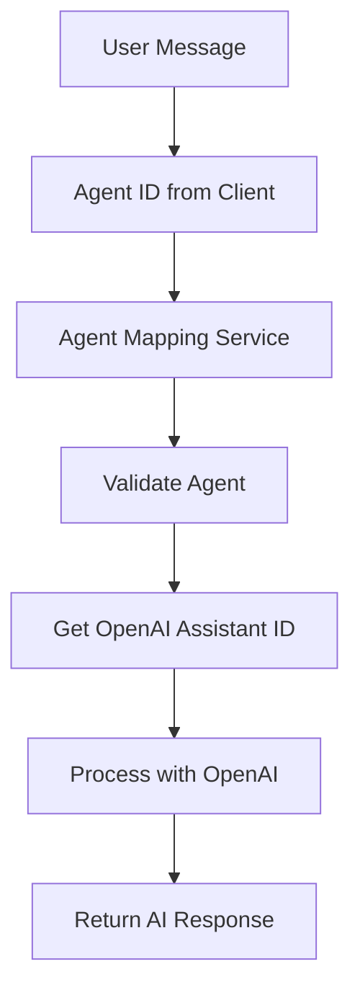

# Agent-to-OpenAI Assistant Mapping Implementation

## Overview

This document describes the implementation of agent-to-OpenAI assistant mapping for the AI Agent Chatbot application. The system now properly maps internal agent IDs to OpenAI assistant IDs for seamless AI integration.

## 🏗️ Architecture

### Agent Model Structure

The `Agent` model includes the following key fields:

```javascript
{
  title: String,                    // Agent display name
  description: String,              // Agent description
  openai_assistant_id: String,     // OpenAI Assistant ID (required, unique)
  status: String,                  // 'active' or 'inactive'
  category: String,                // Agent category
  tags: [String],                  // Agent tags
  isPaid: Boolean,                 // Whether agent requires payment
  // ... other fields
}
```

### Mapping Flow



## 🛠️ Implementation Details

### Agent Mapping Service

The `AgentMappingService` (`src/services/agentMapping.service.js`) provides:

#### `getAssistantIdByAgentId(agentId)`
- Validates agent exists and is active
- Checks for OpenAI assistant ID configuration
- Returns the OpenAI assistant ID
- Throws errors for invalid/inactive agents

#### `validateAgent(agentId)`
- Quick validation without throwing errors
- Returns boolean indicating agent validity
- Checks existence, status, and OpenAI assistant ID

#### `getAgentDetails(agentId)`
- Returns comprehensive agent information
- Includes OpenAI assistant ID and metadata
- Useful for debugging and logging

#### `getActiveAgents()`
- Returns all active agents with OpenAI assistant IDs
- Useful for agent listing and selection

### Socket Service Integration

The `SocketService` now properly handles agent mapping:

```javascript
// Get OpenAI assistant ID from agent mapping service
const assistantId = await agentMappingService.getAssistantIdByAgentId(data.agentId);

// Use the assistant ID for OpenAI API calls
const run = await client.beta.threads.runs.create(threadId, {
  assistant_id: assistantId
});
```

## 🔍 Database Operations

### Agent Validation

```javascript
// Validate agent exists and is properly configured
const isValidAgent = await agentMappingService.validateAgent(agentId);
if (!isValidAgent) {
  throw new Error(`Invalid agent ID: ${agentId}`);
}
```

### Getting Assistant ID

```javascript
// Get OpenAI assistant ID by agent ID
const assistantId = await agentMappingService.getAssistantIdByAgentId(agentId);
console.log(`Using OpenAI assistant ID: ${assistantId}`);
```

### Agent Details Retrieval

```javascript
// Get comprehensive agent information
const agentDetails = await agentMappingService.getAgentDetails(agentId);
console.log('Agent:', agentDetails.title);
console.log('OpenAI Assistant ID:', agentDetails.openai_assistant_id);
```

## 🧪 Testing

### Test Script

Run the agent mapping test script:

```bash
node test-agent-mapping.js
```

The test script verifies:
- Agent creation with OpenAI assistant ID
- Assistant ID retrieval by agent ID
- Agent validation (valid/invalid cases)
- Agent details retrieval
- Active agents listing
- Error handling for invalid agents
- Error handling for inactive agents
- Error handling for agents without OpenAI assistant IDs

### Manual Testing

1. **Create an agent** with OpenAI assistant ID:
   ```javascript
   const agent = await Agent.create({
     title: 'My Assistant',
     openai_assistant_id: 'asst_123456789',
     status: 'active'
   });
   ```

2. **Test agent mapping**:
   ```javascript
   const assistantId = await agentMappingService.getAssistantIdByAgentId(agent._id);
   console.log('OpenAI Assistant ID:', assistantId);
   ```

3. **Test WebSocket message** with agent ID:
   ```javascript
   socket.emit('message', {
     userId: 'user123',
     agentId: agent._id,
     message: 'Hello!'
   });
   ```

## 🚀 Usage Examples

### WebSocket Message Flow

```javascript
// Client sends message with agent ID
socket.emit('message', {
  userId: 'user123',
  agentId: 'agent456',  // Internal agent ID
  message: 'Hello, how are you?'
});

// Server processes:
// 1. Validates agent exists and is active
// 2. Gets OpenAI assistant ID from agent
// 3. Processes message with OpenAI
// 4. Returns AI response
```

### API Integration

```javascript
// Get all active agents for frontend
const activeAgents = await agentMappingService.getActiveAgents();
res.json({ success: true, data: activeAgents });
```

### Error Handling

```javascript
try {
  const assistantId = await agentMappingService.getAssistantIdByAgentId(agentId);
  // Process with OpenAI
} catch (error) {
  if (error.message.includes('Agent not found')) {
    // Handle invalid agent
  } else if (error.message.includes('not active')) {
    // Handle inactive agent
  } else if (error.message.includes('OpenAI assistant ID')) {
    // Handle missing OpenAI assistant ID
  }
}
```

## 🔧 Configuration

### Agent Setup

To use an agent, ensure it has:

1. **Valid MongoDB ObjectId**
2. **OpenAI Assistant ID** (from OpenAI dashboard)
3. **Active status**
4. **Proper configuration**

```javascript
const agent = await Agent.create({
  title: 'Customer Support Bot',
  description: 'Helps with customer inquiries',
  openai_assistant_id: 'asst_abc123def456',  // From OpenAI
  status: 'active',
  category: 'support',
  tags: ['customer', 'support', 'help'],
  isPaid: false
});
```

### Environment Variables

```bash
MONGO_URI=mongodb://localhost:27017/ai_agent_chatbot
OPENAI_API_KEY=your_openai_key
```

## 📊 Performance Considerations

### Caching

For high-traffic scenarios, consider caching agent mappings:

```javascript
// Example caching implementation
const agentCache = new Map();

async function getCachedAssistantId(agentId) {
  if (agentCache.has(agentId)) {
    return agentCache.get(agentId);
  }
  
  const assistantId = await agentMappingService.getAssistantIdByAgentId(agentId);
  agentCache.set(agentId, assistantId);
  return assistantId;
}
```

### Database Indexing

Ensure proper indexing on the Agent collection:

```javascript
// Index for fast agent lookups
agentSchema.index({ _id: 1, status: 1 });
agentSchema.index({ openai_assistant_id: 1 }, { unique: true });
```

## 🔒 Security

### Agent Validation

- All agent IDs are validated before processing
- Only active agents with valid OpenAI assistant IDs are allowed
- Proper error handling prevents information leakage

### Access Control

- Agents can be marked as paid/free
- Status-based access control (active/inactive)
- Proper error messages for different failure scenarios

## 🐛 Troubleshooting

### Common Issues

1. **"Agent not found"**: Check if agent ID exists in database
2. **"Agent is not active"**: Verify agent status is 'active'
3. **"OpenAI assistant ID not configured"**: Ensure agent has valid OpenAI assistant ID
4. **"Invalid agent ID"**: Check agent ID format and existence

### Debug Mode

Enable debug logging:

```javascript
console.log('Agent ID:', agentId);
console.log('Agent details:', await agentMappingService.getAgentDetails(agentId));
console.log('Assistant ID:', await agentMappingService.getAssistantIdByAgentId(agentId));
```

## 📈 Future Enhancements

### Planned Features

- Agent versioning and updates
- Dynamic agent configuration
- Agent performance metrics
- Agent usage analytics
- Multi-tenant agent management

### Scalability

- Redis caching for agent mappings
- Agent configuration hot-reloading
- Distributed agent management
- Agent load balancing

## 📝 API Reference

### AgentMappingService Methods

#### `getAssistantIdByAgentId(agentId)`
- **Parameters**: `agentId` (string) - Agent ID
- **Returns**: Promise<string> - OpenAI Assistant ID
- **Throws**: Error if agent not found, inactive, or missing OpenAI assistant ID

#### `validateAgent(agentId)`
- **Parameters**: `agentId` (string) - Agent ID
- **Returns**: Promise<boolean> - Whether agent is valid
- **Throws**: None (returns false on error)

#### `getAgentDetails(agentId)`
- **Parameters**: `agentId` (string) - Agent ID
- **Returns**: Promise<Object> - Agent details
- **Throws**: Error if agent not found

#### `getActiveAgents()`
- **Parameters**: None
- **Returns**: Promise<Array> - List of active agents
- **Throws**: Error on database failure

## 🎯 Best Practices

### Agent Management

1. **Always validate agents** before processing messages
2. **Use proper error handling** for different failure scenarios
3. **Log agent usage** for monitoring and analytics
4. **Keep agent configurations** up to date
5. **Test agent mappings** before deployment

### Performance

1. **Cache frequently used agents** for better performance
2. **Use database indexes** for fast agent lookups
3. **Monitor agent usage** for optimization opportunities
4. **Implement proper error handling** to avoid cascading failures

## 📞 Support

For issues or questions regarding agent mapping implementation, please refer to the main application documentation or contact the development team.

