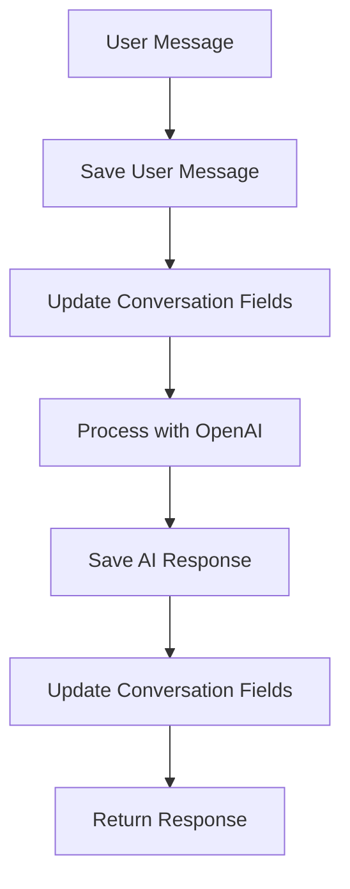

# Conversation Fields Implementation

## Overview

This document describes the implementation of additional conversation tracking fields for the AI Agent Chatbot application. The system now maintains detailed conversation metadata including last message details and unread message counts.

## 🏗️ New Conversation Fields

### Database Schema Updates

The `Conversation` model now includes the following additional fields:

```javascript
{
  // Existing fields...
  user_id: ObjectId,
  agent_id: ObjectId,
  openai_thread_id: String,
  status: String,
  pinned: Boolean,
  
  // New conversation tracking fields
  last_message_text: String,           // Content of the last message
  last_message_send_by: String,        // 'User' or 'System'
  unread_messages_count: Number,       // Count of unread messages
  last_message_timestamp: Date         // Timestamp of the last message
}
```

### Field Descriptions

#### `last_message_text`
- **Type**: String
- **Default**: Empty string
- **Purpose**: Stores the content of the most recent message in the conversation
- **Updates**: Updated whenever a new message is sent (user or AI)

#### `last_message_send_by`
- **Type**: String
- **Enum**: ['User', 'System']
- **Default**: 'User'
- **Purpose**: Indicates who sent the last message
- **Updates**: Set to 'User' for user messages, 'System' for AI responses

#### `unread_messages_count`
- **Type**: Number
- **Default**: 0
- **Purpose**: Tracks the number of unread messages in the conversation
- **Updates**: Incremented only for AI/system messages (not for user messages)

#### `last_message_timestamp`
- **Type**: Date
- **Default**: Current timestamp
- **Purpose**: Records when the last message was sent
- **Updates**: Updated with the timestamp of the most recent message

## 🔄 WebSocket Chat Flow Updates

### Message Processing Flow



### Implementation Details

#### User Message Processing
When a user sends a message:
1. **Save user message** to database
2. **Update conversation** with:
   - `last_message_text`: User's message content
   - `last_message_send_by`: 'User'
   - `last_message_timestamp`: Current timestamp
   - `unread_messages_count`: **NOT incremented** (user messages don't count as unread)

#### AI Response Processing
When AI generates a response:
1. **Save AI response** to database
2. **Update conversation** with:
   - `last_message_text`: AI's response content
   - `last_message_send_by`: 'System'
   - `last_message_timestamp`: Current timestamp
   - `unread_messages_count`: **Incremented by 1** (AI messages count as unread)

## 🛠️ API Endpoints

### Updated Endpoints

#### GET `/chats` - List Conversations
Now returns conversations sorted by `last_message_timestamp` with populated agent details:

```json
{
  "success": true,
  "data": [
    {
      "_id": "conversation_id",
      "user_id": "user_id",
      "agent_id": {
        "_id": "agent_id",
        "title": "Agent Name",
        "description": "Agent Description",
        "icon": "agent_icon",
        "color": "agent_color"
      },
      "last_message_text": "Hello, how can I help?",
      "last_message_send_by": "System",
      "unread_messages_count": 5,
      "last_message_timestamp": "2024-01-15T10:30:00Z",
      "status": "active",
      "pinned": false,
      "createdAt": "2024-01-15T09:00:00Z",
      "updatedAt": "2024-01-15T10:30:00Z"
    }
  ]
}
```

### New Endpoints

#### GET `/chats/unread-count` - Get Total Unread Count
Returns the total number of unread messages across all conversations for the authenticated user.

```json
{
  "success": true,
  "data": {
    "totalUnread": 15,
    "userId": "user_id"
  }
}
```

#### POST `/chats/:conversationId/mark-read` - Mark Conversation as Read
Resets the unread count for a specific conversation to 0.

```json
{
  "success": true,
  "message": "Conversation marked as read",
  "data": {
    "conversationId": "conversation_id",
    "unread_messages_count": 0
  }
}
```

## 🔧 Implementation Details

### Socket Service Updates

#### `saveMessages(conversationId, userId, agentId, userMessage, aiResponse)`
- Saves both user message and AI response
- Updates conversation fields for both messages
- Increments unread count for each message

#### `updateConversationWithUserMessage(conversationId, userId, userMessage)`
- Updates conversation with user message details
- Sets `last_message_send_by` to 'User'
- Increments unread count

#### `updateConversationWithAIResponse(conversationId, aiResponse)`
- Updates conversation with AI response details
- Sets `last_message_send_by` to 'System'
- Increments unread count

### Database Operations

#### Conversation Updates
```javascript
// Update conversation with user message
await Conversation.findByIdAndUpdate(conversationId, {
  last_message_text: userMessage,
  last_message_send_by: 'User',
  last_message_timestamp: new Date(),
  unread_messages_count: { $inc: 1 },
  updatedAt: new Date()
});

// Update conversation with AI response
await Conversation.findByIdAndUpdate(conversationId, {
  last_message_text: aiResponse,
  last_message_send_by: 'System',
  last_message_timestamp: new Date(),
  unread_messages_count: { $inc: 1 },
  updatedAt: new Date()
});
```

#### Unread Count Aggregation
```javascript
// Get total unread count for user
const result = await Conversation.aggregate([
  { $match: { user_id: userId } },
  { $group: { _id: null, totalUnread: { $sum: '$unread_messages_count' } } }
]);
```

## 🧪 Testing

### Test Script
Run the conversation fields test script:

```bash
node test-conversation-fields.js
```

The test script verifies:
- Conversation creation with new fields
- User message updates
- AI response updates
- Multiple message updates
- Conversation listing with new fields
- Unread count aggregation
- Mark as read functionality

### Manual Testing

1. **Send a message** via WebSocket:
   ```javascript
   socket.emit('message', {
     userId: 'user123',
     agentId: 'agent456',
     message: 'Hello!'
   });
   ```

2. **Check conversation fields**:
   ```javascript
   const conversation = await Conversation.findById(conversationId);
   console.log('Last message:', conversation.last_message_text);
   console.log('Sent by:', conversation.last_message_send_by);
   console.log('Unread count:', conversation.unread_messages_count);
   ```

3. **Mark as read**:
   ```javascript
   await fetch('/api/chats/conversationId/mark-read', {
     method: 'POST',
     headers: { 'Authorization': 'Bearer token' }
   });
   ```

## 📊 Performance Considerations

### Database Indexing
Ensure proper indexing for optimal performance:

```javascript
// Index for conversation listing
conversationSchema.index({ user_id: 1, last_message_timestamp: -1 });

// Index for unread count queries
conversationSchema.index({ user_id: 1, unread_messages_count: 1 });
```

### Query Optimization
- Use `lean()` for read-only operations
- Implement pagination for large conversation lists
- Cache frequently accessed conversation data

## 🔍 Use Cases

### Frontend Integration

#### Conversation List
```javascript
// Get conversations with last message preview
const conversations = await fetch('/api/chats', {
  headers: { 'Authorization': 'Bearer token' }
});

// Display conversation list with:
// - Last message preview
// - Unread count badge
// - Timestamp
// - Sender indicator
```

#### Unread Count Badge
```javascript
// Get total unread count for badge
const unreadData = await fetch('/api/chats/unread-count', {
  headers: { 'Authorization': 'Bearer token' }
});

// Display unread count badge
if (unreadData.totalUnread > 0) {
  showBadge(unreadData.totalUnread);
}
```

#### Mark as Read
```javascript
// Mark conversation as read when user opens it
await fetch(`/api/chats/${conversationId}/mark-read`, {
  method: 'POST',
  headers: { 'Authorization': 'Bearer token' }
});
```

## 🚀 Future Enhancements

### Planned Features
- **Message Status Tracking**: Track read/unread status per message
- **Typing Indicators**: Show when users are typing
- **Message Reactions**: Allow users to react to messages
- **Message Search**: Search within conversations
- **Conversation Archiving**: Archive old conversations
- **Message Encryption**: Encrypt sensitive messages

### Scalability
- **Redis Caching**: Cache conversation metadata
- **Message Queuing**: Handle high-volume message processing
- **Database Sharding**: Distribute conversations across shards
- **Real-time Updates**: WebSocket notifications for conversation updates

## 🔒 Security Considerations

### Data Privacy
- Conversation data is only accessible by the conversation owner
- Proper authentication for all conversation endpoints
- Secure WebSocket connections

### Data Validation
- Validate all conversation field updates
- Sanitize message content
- Prevent unauthorized conversation access

## 📝 API Reference

### Conversation Fields

#### `last_message_text`
- **Type**: String
- **Description**: Content of the most recent message
- **Example**: "Hello, how can I help you today?"

#### `last_message_send_by`
- **Type**: String
- **Enum**: ['User', 'System']
- **Description**: Who sent the last message
- **Example**: "System"

#### `unread_messages_count`
- **Type**: Number
- **Description**: Number of unread messages
- **Example**: 5

#### `last_message_timestamp`
- **Type**: Date
- **Description**: When the last message was sent
- **Example**: "2024-01-15T10:30:00Z"

### API Endpoints

#### GET `/chats`
- **Description**: List user's conversations
- **Response**: Array of conversations with new fields
- **Sorting**: By `last_message_timestamp` (newest first)

#### GET `/chats/unread-count`
- **Description**: Get total unread message count
- **Response**: `{ totalUnread: number, userId: string }`

#### POST `/chats/:conversationId/mark-read`
- **Description**: Mark conversation as read
- **Response**: `{ success: true, message: string, data: object }`

## 🐛 Troubleshooting

### Common Issues

1. **Unread count not updating**: Check if conversation updates are being called
2. **Last message not showing**: Verify message saving and conversation updates
3. **Performance issues**: Check database indexing and query optimization
4. **WebSocket errors**: Ensure proper error handling in socket service

### Debug Mode

Enable debug logging:

```javascript
console.log('Conversation update:', {
  conversationId,
  last_message_text,
  last_message_send_by,
  unread_messages_count
});
```

## 📞 Support

For issues or questions regarding conversation field implementation, please refer to the main application documentation or contact the development team.
